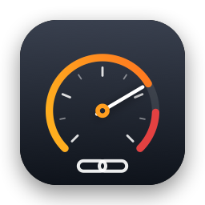
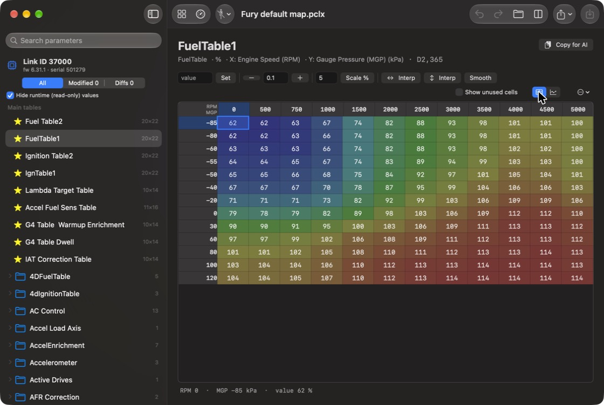
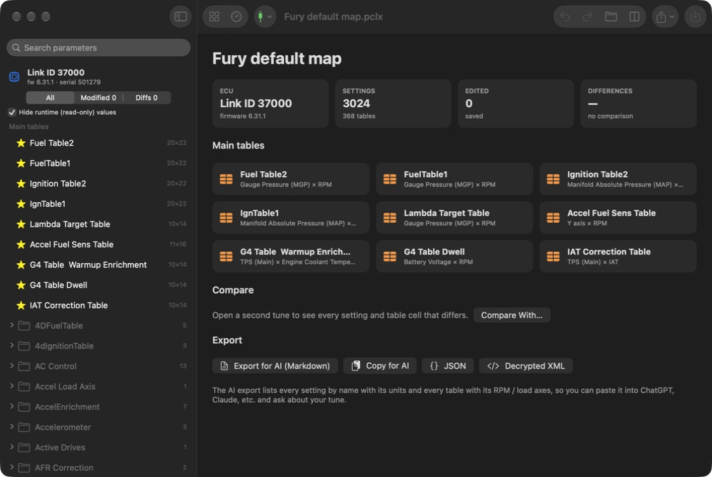
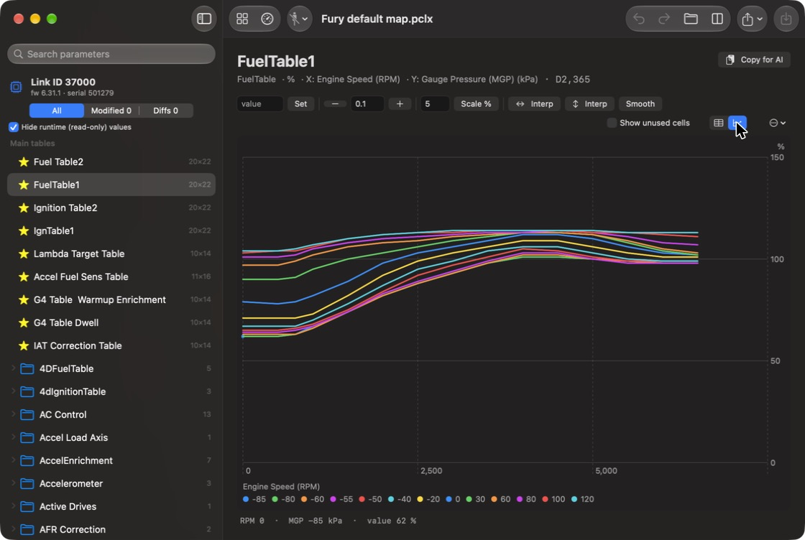
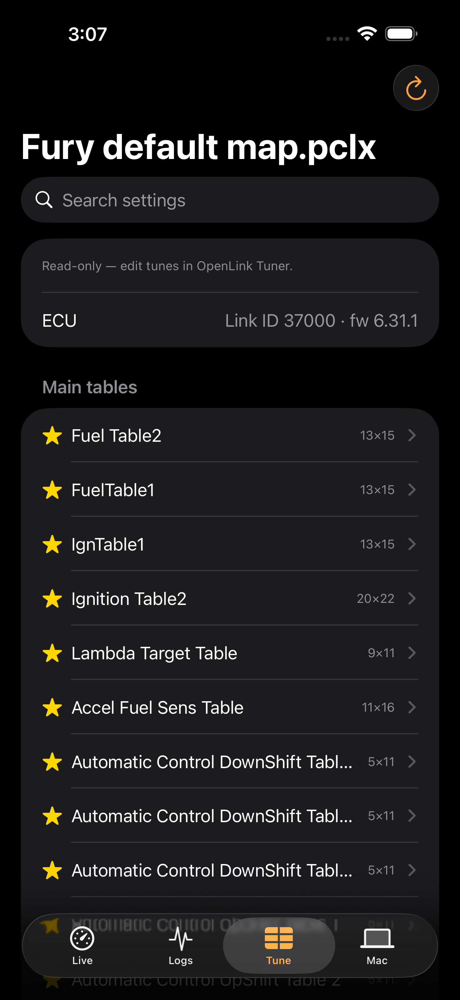
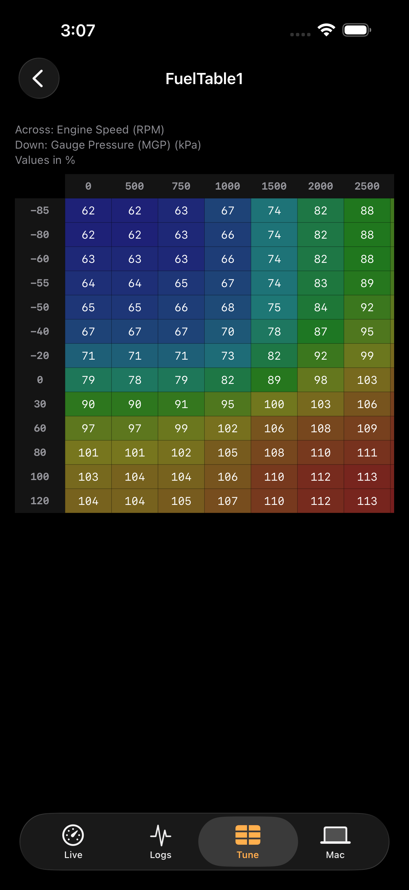

<p align="center">
  
</p>

<h1 align="center">OpenLink Tuner</h1>

<p align="center">
  <b>Open-source tuning software for Link ECUs — on your Mac and iPhone.</b><br>
  Read your tune straight off the ECU, edit tables like PCLink, compare tunes, watch live data,
  log, and send it all to your phone. No Windows, no Boot Camp, no virtual machine.
</p>

<p align="center">
  <a href="../../releases/latest"></a>
</p>

<p align="center">
  
  
  
  
  
</p>

<p align="center">
  
</p>

---

## Why

Link's PCLink only runs on Windows. If you tune or own a Link-powered car and use a Mac,
your options were a Windows laptop or a VM fighting with USB passthrough. OpenLink Tuner is a
native Mac app (and iPhone companion) that opens your tune files, **reads the tune straight
off the ECU over the Link USB cable**, and shows live data — built from scratch in Swift,
free and open source.

## Features

**Tune files (`.pclx`, `.pcl5`)**
- Opens Link tune files natively — every setting by name, grouped like PCLink, searchable.
- **Table editor that feels like real tuning software:** heat-map grid with the real RPM and
  load axes, range selection, type-to-set, ± step, scale %, axis-weighted interpolation,
  smoothing, Excel-compatible copy/paste, graph view, unlimited undo/redo.
- Values are kept inside each setting's allowed range.
- **Compare two tunes** cell by cell (difference view, copy cells across, comparison report).
- Saves standard `.pclx` files.

**Straight from the ECU** — plug in the Link USB cable and it:
- detects the cable automatically,
- **reads the whole tune off the ECU** (about 40 s for ~3,000 settings) when no tune is open,
- or **compares the open tune file with what's actually in the car**,
- streams **live data** — RPM, MAP, throttle, lambda, temps, ignition, injector duty, battery,
  oil and fuel pressure — with sparklines and warnings,
- records **CSV logs**, and reconnects by itself when the ignition goes off and on.

**iPhone (OpenLink Mobile)**
- Reconnects to an approved Mac over encrypted Wi-Fi. In OpenLink Mobile, tap **Mac → Pair with a Mac**. On the Mac, open **Live**, enter a phone name and the private code shown on the iPhone, then click **Approve Phone**. Click **Revoke** there to disconnect that phone and remove its access. Update both apps to use pairing.
- Big RPM gauge + live tiles, screen stays on.
- Every log with charts, scrubbing and min/avg/max; share as CSV.
- Browse the tune (read-only) with heat-mapped tables.
- Start/stop recording on the Mac from the phone.

**AI-ready export** — one click exports (or copies) the whole tune as Markdown with every
setting named and every table with its axes, so you can paste it into ChatGPT, Claude, etc.
and ask about your tune. Also JSON and raw decrypted XML.

**Copilot** — a ChatGPT-style tuning assistant in the sidebar. It sees the open tune, the CSV logs
you attach (+ button or drag & drop) and live ECU data, and talks like a pro tuner. Ask in plain
words ("fix my fuel from this log", "add 3% fuel above 5000 RPM on boost", "set up launch control");
it answers and shows each change as a card with a preview. Click **Apply** to put it in the open
tune (undoable, clamped to each setting's allowed range). Nothing is written to the ECU. Fuel is
corrected from warm, steady-state lambda across every logged sample. Answers come from your
OpenAI API key (saved in the Keychain, gear icon) or your ChatGPT account (needs Node.js 22.12+;
run `bash src/scripts/install-chatgpt-plan.sh` once).

<p align="center">
  
  
</p>
<p align="center">
  
  &nbsp;&nbsp;
  
</p>

## Safety first: read-only

OpenLink **never writes to your ECU.** It can only send identify, version and read commands;
every write, store, reset and firmware command is blocked in code — twice (in the protocol
layer and again right before bytes reach the USB cable). Editing a tune changes the file on
your Mac, never the car. To flash a tune you still use PCLink.

## Compatibility

| | Status |
|---|---|
| **Link G4X Xtreme Plug-in family** (Link ID 23000), firmware 6.31.2 | ✅ **Tested on a real car** — tune read (matched the PCLink file exactly), live data, logging |
| Other Link G4X ECUs — Xtreme (18000), Storm (19000), Fury (37000), Atom (14000), Monsoon (41000) | 🟡 Should work (same protocol), **not yet tested** — reports welcome |
| Link G4+ tune files (`.pcl5`) | ✅ Open, edit, compare, export |
| Link G4+ / G5 over USB | ⬜ Not supported yet |
| Mac | macOS 14 Sonoma or newer, **Apple Silicon** (M1 and later) |
| iPhone / iPad | iOS / iPadOS 17 or newer |
| Cable | The standard Link USB cable (FTDI, USB IDs 0403:7068–706F) — driver included |

Tested a model that isn't listed? Please [open an issue](../../issues) — see
[docs/G4X-PROTOCOL.md](docs/G4X-PROTOCOL.md#trying-openlink-on-a-link-ecu-that-hasnt-been-tested-yet).

## Install

### Mac
1. Download **`OpenLink-Tuner-macOS.zip`** from the [latest release](../../releases/latest), unzip,
   and drag **OpenLink Tuner** to Applications.
2. First launch: the app isn't notarized by Apple (that needs a paid developer account), so
   macOS blocks it once. Open **System Settings → Privacy & Security**, scroll down and
   click **Open Anyway** (or right-click the app → Open).
3. Allow **local network** access when asked — that's how your iPhone finds the Mac.

The USB driver (libftdi) is built in; nothing else to install.

### iPhone
- **Sideloadly / AltStore:** install **`OpenLink-Mobile-iOS.ipa`** from the release with your Apple ID.
- **Xcode:** open `src/OpenLink.xcodeproj`, pick the **OpenLink Mobile** scheme, set your Team
  under Signing & Capabilities, and run it on your phone.

With a free Apple ID iOS asks you to reinstall every 7 days. Allow **Local Network** access on
first launch.

## First time with your ECU

To read a tune, OpenLink needs to know the layout of your ECU model once. It learns it
automatically the first time you **open any tune file from that ECU** (e.g. one your tuner sent
you) — or use **ECU → Import ECU Layouts from PCLink Installer…** with Link's free PCLink
installer from linkecu.com (needs `brew install innoextract`). After that:

1. Ignition on, plug in the Link USB cable.
2. With no tune open, OpenLink reads the tune off the ECU and opens it — **Save as .pclx**
   to keep a backup.
3. Click **Live** for gauges; open OpenLink Mobile on your iPhone.

## Build from source

```bash
git clone https://github.com/matt87-maker/openlink-tuner.git
cd openlink-tuner/src
open OpenLink.xcodeproj        # schemes: OpenLink Tuner, OpenLink Mobile, openlink (CLI)
```

Requires Xcode 16+. The Mac target bundles Homebrew's `libftdi` (`brew install libftdi`) at
build time. The project is generated from `src/project.yml` with
[XcodeGen](https://github.com/yonaskolb/XcodeGen) — run `xcodegen generate` after adding files.

There's also a command-line tool:

```bash
openlink info    tune.pclx
openlink export  tune.pclx tune.md     # AI-readable (or .json)
openlink diff    a.pclx b.pclx report.md
openlink decrypt tune.pclx tune.xml
```

## How it works

Everything was worked out for interoperability: the tune file format, and Link's USB
protocol (framing, CRC, commands, and the reply format confirmed on a real ECU). It's all
documented in **[docs/G4X-PROTOCOL.md](docs/G4X-PROTOCOL.md)** so others can build on it.

## Contributing

The most useful thing right now: **test reports from other Link ECUs** (model, firmware, what
worked, and the USB log). Bug reports, pull requests and ideas are welcome too.

## Disclaimer

OpenLink Tuner is an independent open-source project. It is **not affiliated with, endorsed by
or supported by Link Engine Management Ltd.** "Link", "G4X", "G4+", "G5" and "PCLink" are
trademarks of their respective owners and are used only to describe compatibility. No Link
software or tune files are included. Engine tuning can damage engines — use at your own risk,
and use Link's official PCLink to write tunes to your ECU.

## License

[MIT](LICENSE). Bundled third-party libraries: see [THIRD_PARTY_NOTICES.md](THIRD_PARTY_NOTICES.md).
